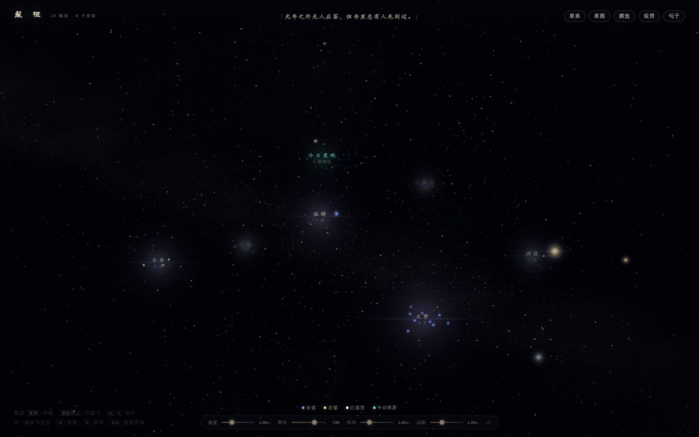
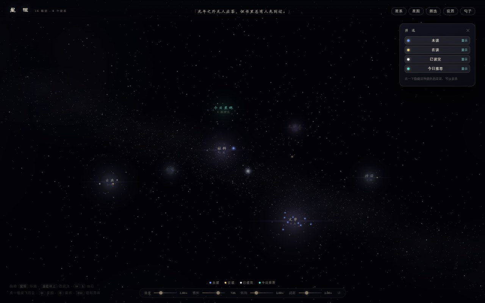
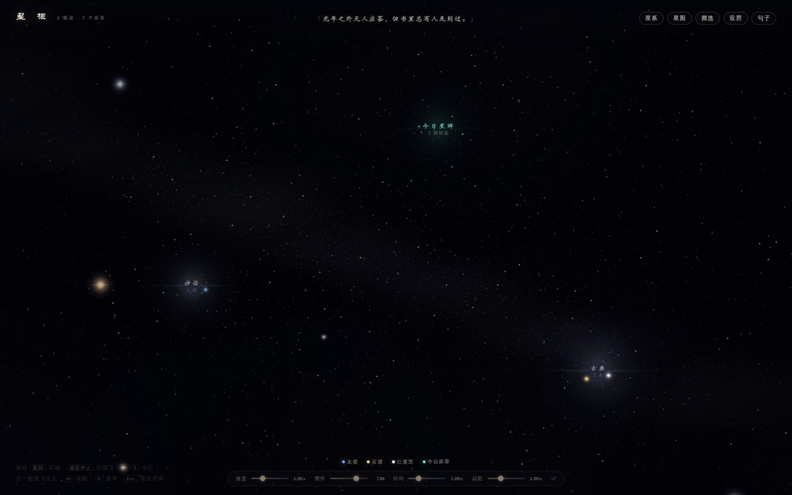

# 星槎 · Stellar Shelf

一个私人的书架，长成了一片星空。

**打开就是一个可以漂进去的宇宙**——星系是分类，星的颜色是阅读状态，靠近一颗星才看清它是一本书，翻开就能读。数据全部在本地，不联网、不上传、不分享。



## 它是什么

- **星系 = 题材**：古典 / 小说 / 神话 / 文学 / 社科 / 科学 / 艺术 / 生活。每本书按标签自动归入一个星系。
- **颜色 = 状态**：蓝（未读）、黄（在读）、白（已读完）、青（今日推荐，会呼吸）。
- **远近 = 层次**：远看是一颗星，靠近二十几「光年」内，封面才会浮出来。
- **能读**：翻开进入全屏阅读器，日常 / 护眼 / 米黄 / 夜间 / 星空 / 自定义六种显示模式，八种中文字体（含开源的霞鹜文楷）。
- **能记**：划词摘录、写想法，摘录会回到正文里点亮。
- **能收**：上传 EPUB / PDF / TXT / MOBI / AZW3 / DOCX / Markdown；豆瓣推荐源可自行开启。




## 安装

需要 DeepSeek Harness 0.1.7 及以上。

```bash
dsh plugin --profile web add @zhangxij/stellar-shelf
```

或者在 Harness 的插件管理里搜 `stellar-shelf`。

**装完不用配置**：空书库会自动装入三本公版书（《洛神赋》《诗经》《山海经》），并把它们设成"已读完 / 在读 / 未读"三种状态，附两条示例笔记。所以第一眼就能看到两个星系、三种颜色的星、以及可以直接点开读的目录。



## 数据在哪

- 安装版：`%LOCALAPPDATA%\stellar-shelf`（macOS/Linux 为 `~/.stellar-shelf`）
- 可用环境变量接管：`SHELF_DATA_DIR`、`SHELF_PORT`

数据库是 SQLite，正文是普通 HTML 文件，随时可以整个目录拷走。

## 隐私

- 书架数据全部本地，没有任何上传。
- **豆瓣推荐源默认关闭**；开启后才会去抓豆瓣读书的公开页面。关闭时「今日星群」只从你自己没读完的书里挑。

## 权限说明

插件会启动一个本地 HTTP 服务（127.0.0.1，端口从 7317 起自动找空闲），并读写自己的数据目录。除此之外不访问网络、不执行外部命令。

## 许可证

MIT。随包附带的霞鹜文楷字体为 SIL OFL 1.1（精简包不含字体）。

书源为 Project Gutenberg 公版书，书目与封面信息来自豆瓣读书，仅作文本与元数据的展示，请支持正版。
